<p align="center">
  <picture>
    <source media="(prefers-color-scheme: dark)" srcset="docs/assets/banner-dark.svg">
    
  </picture>
</p>

<p align="center">
  <a href="README.md">中文</a>&nbsp;&nbsp;·&nbsp;&nbsp;<b>English</b>
</p>

<p align="center">
  <a href="https://github.com/accomplish07zrh-eng/vela-browser/releases">Set sail</a>
  &nbsp;·&nbsp;
  <a href="#wall">The wall</a>
  &nbsp;·&nbsp;
  <a href="#identities">Identities</a>
  &nbsp;·&nbsp;
  <a href="#proxies">Doors</a>
  &nbsp;·&nbsp;
  <a href="#cooling">Lights out</a>
  &nbsp;·&nbsp;
  <a href="#agents">Many hands</a>
  &nbsp;·&nbsp;
  <a href="#plugins">Tools</a>
  &nbsp;·&nbsp;
  <a href="#build">Shipbuilding</a>
</p>

<br>

<p align="center"><i>
One window, one lamp.<br>
Those beneath them never meet,<br>
and each door opens onto its own wind.
</i></p>

<p align="center"><sub>VELA　Latin for “sails”, and a constellation of the southern sky</sub></p>

<br>

## Prologue

<p align="center">
Your desk holds many windows.<br>
Behind each one lives a whole person:<br>
a fingerprint grown like the rings of a tree,<br>
a tide that knows only one doorstep,<br>
cookies like a letter left half-written in a drawer.
</p>

<p align="center">
They never call on one another, and never borrow a neighbour's road.<br>
Behind separate walls, each lights its own lamp and puts it out alone.
</p>

<p align="center">· · ·</p>

<p align="center">
And the wall stands right beside your hand.<br>
No account, no cloud,<br>
no keeper far away holding a spare key to your desk.
</p>

<br>

<a name="wall"></a>

## I　The Wall

<p align="center"><sub>一面墙</sub></p>

<p align="center"><i>
One group is one row, and one row is a river.<br>
Neighbouring rivers run against each other,<br>
lamps on either bank, looking across the water.
</i></p>

Slower, and slower still,\
like two night trains passing on opposite tracks,\
one lit pane after another gliding evenly past.

Even the windows resting farther back never freeze into painted stills:\
their lamps stay lit, and whatever stirs on the page keeps moving on the wall.

　　Then you double-click one of them.

It comes forward to meet you,\
and the whole wall gathers into a single frame:\
you can click, write, and scroll page by page,\
no different from a house with its own gate.

Set down a word in one window,\
and the others pick up the pen at the same beat:\
one voice leads, the choir answers, ripples opening in a single instant.\
Paper white by day, ink dark by night,\
every menu and question cut from the same sheet—\
press <kbd>Esc</kbd>, and every drawer folds cleanly back behind the wall.

<details>
<summary><b>Under the lamp</b></summary>
<br>

- **Live workbench**: open browsers spread across one wall; windows left in the background keep running and refresh live frames without flicker. Double-click any tile to enlarge and click, type, or scroll inside it directly.
- **River lanes**: each group forms a row; rows can loop end to end with neighbouring rows drifting in opposite directions, or narrow to a single group and taller lanes.
- **Sync**: make one environment the leader and the others follow its clicks and keystrokes—the ripples opening together along the banner's top row.
- **Quiet desktop**: on Windows, environment windows can stay off the taskbar; only the taskbar button goes, while the window and everything a page can read stay intact.
- **Paper chrome & dock**: Windows and Linux draw a custom title bar matching the theme; navigation tucks into a floating dock at the bottom, other pages rise as glass sheets from below (two columns on wide screens for Settings and Extensions), and <kbd>Esc</kbd> returns to the wall.

</details>

<br>

<a name="identities"></a>

## II　A Thousand Roads

<p align="center"><sub>千种来路</sub></p>

<p align="center"><i>
One desk, a thousand origins.
</i></p>

Someone comes in out of the Tokyo rain, someone out of the Berlin snow;\
one speaks only English, one answers in the soft vowels of Suzhou.

How wide the screen, which typefaces sit in the drawer,\
which voice hides inside the sound card,\
what shade of dust settles on the graphics chip—\
all of it written into their papers the first time they open the door,\
and, until they move to another exit, never altered by a stroke.

Close the door, and the letter stays under its paperweight.\
Open it again, and the ink has not yet dried.

<details>
<summary><b>Under the lamp</b></summary>
<br>

- **Three engines**: choose Vela Chromium 155, CloakBrowser, or Vela Firefox per environment; WebKit is experimental. Missing platform font packs are fetched on demand.
- **Full fingerprints**: screen, fonts, speech voices, media devices, WebGL, WebRTC, locale, and timezone are generated per environment and stay fixed for its lifetime (when changing proxy exits, timezone—unless manually pinned—and WebRTC public IP follow the new exit).
- **Sessions kept whole**: cookies (including Firefox session cookies) and site storage are saved on close and restored as they were.
- **In bulk**: groups, portable import and export, a trash bin, and scheduled tasks.

</details>

<br>

<a name="proxies"></a>

## III　Each by Its Own Door

<p align="center"><sub>各走各的门</sub></p>

<p align="center"><i>
Carriages clatter past outside the wall;<br>
inside, every window steps onto its own stone sill.
</i></p>

Your computer still travels its own road:\
no virtual network card across the front gate, no system proxy touched, no routing table altered.\
Every window that goes out through a proxy stands behind its own local relay;\
if it holds a subscription protocol, it lights its own small stove behind the door—\
one room, one hearth, no smoke drifting into a neighbour's chimney.

Subscriptions pass through strict sieves at the threshold:\
blank slips marked `direct` or `reject` stay outside the sill,\
provider notices counting remaining traffic sit aside on their own tray,\
and any line carrying an unfamiliar word is laid down whole rather than stripped of its lock to cross the bridge.\
A shared pass from a provider may carry several travellers across the same ferry, with every companion clearly circled on the ledger;\
a hand-planted gate defaults to one traveller alone, so two shadows never step into the same footprint.

Every address and key locks inside an iron box keyed to this computer and this user alone.\
Nothing inside a window asks the local street for directions or shouts across the LAN;\
if a rope snaps or a stove goes cold mid-crossing, the ferry stays moored at the bank—never wading home on your own bare road.

　　And if a household must change its gate mid-journey:

a scout first tests the wind outside the new crossing,\
the half-finished letter is folded into the drawer, the door shuts cleanly and reopens as before—\
and as the pane swings back, the wall clock and the river outside already keep the new place's time,\
checked once more through its own keyhole to be sure nobody mistook it for your own door.

<details>
<summary><b>Under the lamp</b></summary>
<br>

- **Proxy pool & subscriptions**: import once under **Proxies → Proxy pool** and assign across profiles. Paste `http` / `https` / `socks5` (`host:port:user:pass` or URLs) or add HTTPS subscription links (auto-detects Clash / mihomo YAML, sing-box JSON, base64 or plaintext URIs; fetches with `clash.meta` first and falls back to `v2rayN`; reads `subscription-userinfo` for traffic balance and expiry warnings).
- **Protocols & strict filtering**: supports `http`, `https`, `socks5`, `Shadowsocks`, `VMess`, `VLESS` (with Vision, REALITY, and ECH), `Trojan`, `Hysteria2`, `TUIC`, and `AnyTLS`. Non-exit rules (`direct`, `reject`, `reject-drop`, `dns`, `pass`, `block`, group refs) and info entries ("Traffic", "Expire", etc.) are never treated as usable exits; unknown fields mark a node unsupported whole instead of dropping TLS or transport settings.
- **Sharing defaults & sticky assignment**: subscription nodes default to shareable while flagging every profile sharing the same verified exit IP; manually added nodes (such as static residential or dedicated IPs) default to exclusive (`1` profile max) to avoid account linkage. Dead or removed nodes keep their snapshot and prompt rather than silently moving a profile to another IP.
- **Zero global edits & per-profile kernel**: no TUN adapter, no system proxy, no routing-table or hosts changes. Every proxied profile goes through its own `127.0.0.1` relay; protocol nodes each run an isolated `sing-box` process (downloaded on first use from official releases, verified against pinned SHA-256 hashes, watchdog-supervised, crash leftovers cleaned up, zero `direct` outbound with `final: block`, dedicated DoH only for the node hostname itself).
- **Anti-leak & kill switch**: Chromium runs with `--host-resolver-rules` (`MAP * ~NOTFOUND`) and `MediaRouter` disabled (no LAN mDNS multicast); Firefox enforces remote DNS, disables prefetch, TRR, and native HTTPS RR queries, and turns off `allow_bypass` and `failover_direct`. If a relay or kernel stops, traffic fails closed—never falling back to direct egress.
- **Sealed at rest & export guard**: subscription links, node addresses, and credentials are sealed with AES-256-GCM under a per-directory `proxy-pool.key`, bound on Windows by DPAPI to the current user account (owner-only file permissions on macOS/Linux). Portable exports lock subscription-bound profiles until another proxy is assigned on the destination machine.
- **Changing exits**: switch exits from the profile editor or via MCP. A pre-flight check tests the new exit first (failing cleanly without changing anything); open browsers save their session and tabs, confirm teardown, reopen in their original windowed or headless mode with tabs restored and timezone & WebRTC aligned to the new exit, then re-verify the exit through their own relay (closing immediately if it ever matches the host's direct IP). Guarded by a per-profile mutex, 30-second cooldown, and switch history.

</details>

<br>

<a name="cooling"></a>

## IV　Lights Out, Not Gone

<p align="center"><sub>熄灯，不散场</sub></p>

<p align="center">
  <picture>
    <source media="(prefers-color-scheme: dark)" srcset="docs/assets/cooling-dark.svg">
    
  </picture>
</p>

<p align="center"><i>
The night grows late.<br>
The window left alone the longest is the first to go dark.
</i></p>

It is not a goodbye.

The letter is folded into the drawer;\
the key waits under the flowerpot by the door.\
The room still hangs on the wall, only dim,\
a small frost-flower on the glass.

　　The memory level falls,\
　　　　and the computer draws an easier breath.

Touch it once when you return—\
the tea is still warm, the book still open at the page.

<details>
<summary><b>Under the lamp</b></summary>
<br>

- **When**: when physical memory use stays above the threshold (on macOS, droppable file cache counts as available), Vela picks the browser left idle the longest and closes it along the Close path—saving its session before releasing the process.
- **Still on the wall**: the tile never vanishes from the workbench; it dims and is marked cooled. Double-click or press Wake to bring back its sign-ins and tabs.
- **Busy rooms untouched**: browsers you are using, or that a script or AI is driving, or that were touched moments ago never cool.
- **Your line**: defaults to 85% memory and 10 minutes idle; both thresholds are adjustable (60%–95%, 1–240 minutes) or can be switched off.

</details>

<br>

<a name="agents"></a>

## V　One Thought, Many Hands

<p align="center"><sub>一个念头，几双手</sub></p>

<p align="center">
  <picture>
    <source media="(prefers-color-scheme: dark)" srcset="docs/assets/agents-dark.svg">
    
  </picture>
</p>

<p align="center"><i>
One thought, split among many hands.<br>
Each dips into its own ink,<br>
none reaching across another's inkstone.
</i></p>

Heavy rain outside.\
Three or four windows on the wall stir at once: Claude Code writes in amber, Codex in blue, Hermes in violet, Cursor in green—\
each carrying its own coloured arrow and badge along the outer glass so you can tell at a glance whose hand holds which window,\
while the page inside sees no shadow of the pen, and the mouse on your desk never twitches.

The pointer walks the way a person does:

setting off with a slight hesitation,\
gathering speed along the curve,\
sometimes overshooting a long reach before settling back.\
It types the way a person does—key by key, pausing at a comma to think;\
or gathers practiced steps into one clean breath.

It sees the dark river under F12 as well:\
whispers in the console, letters crossing the wire, telegrams streaming over WebSocket.\
Yet at every door it knocks first;\
and before changing a window's address or exit IP, it never turns the latch on its own—\
it checks the weather across the pool, hands a slip to your desk, and waits for your nod.

<details>
<summary><b>Under the lamp</b></summary>
<br>

- **MCP & coloured AI pointers**: ships the `Vela Browser` MCP server (`vela-browser-mcp`) for Claude Code, Codex, Cursor, Hermes, OpenClaw, Gemini, and others. Multiple AIs work separate windows concurrently without stepping on one another; each AI renders its own coloured cursor over the workbench card (purely in Vela's view layer—undetectable inside the page).
- **Human-like input & batching**: eased pointer curves with occasional overshoot and settle, scattered hit points inside elements, wheel scrolling, uneven key-by-key rhythm with punctuation pauses, and persistent habits per profile (`vela_humanize` adjusts pace or turns it off). `browser_batch` runs several page actions in one call without redundant snapshots.
- **Developer tools**: `browser_devtools_*` inspects console & exception stacks, network requests & raw response bytes, WebSocket frames, DOM & computed styles, storage & page-scoped cookies (`allCookies` must be requested explicitly), browser-stack `fetch`, and native Chromium CDP across Chromium, Firefox, and WebKit. See [`docs/mcp-devtools.md`](docs/mcp-devtools.md).
- **Pool tools & change approval**: `vela_proxy_pool_list`, `vela_proxy_pool_check`, and `vela_browser_set_proxy` accept only pool `nodeId` values—never raw proxy strings or subscription links from an AI, and never return passwords, UUIDs, or subscription URLs. Because changing an exit changes the IP seen by sites, Vela raises a top-level approval card by default (60-second timeout); configured globally under **Proxies → Proxy pool → AI proxy changes** (`Ask me each time`, `Allow pool proxies without asking`, or `Never allow`).
- **Scripts & local API**: built-in Scripts workbench with a public library supporting JavaScript (`.js`/`.mjs`) and Python (`.py`) Playwright scripts, sequential or concurrent runs across selected profiles, and `devtools.call(...)` inside JS scripts; plus a local HTTP API compatible with AdsPower's `/api/v1`.

</details>

<br>

<a name="plugins"></a>

## VI　Tools That Fit the Hand

<p align="center"><sub>趁手的工具</sub></p>

<p align="center"><i>
For someone setting out on a long road:<br>
a small knife, a coil of rope, a lantern.
</i></p>

Set a small box inside `plugins`,\
one manifest and a few lines of craft,\
and the AI picks up one more trade:

```js
// plugins/page-info/index.mjs
export default function setup(vela) {
  return {
    async summary() {
      const page = vela.page();
      const errors = await vela.devtools("console", { level: "error" });
      return { title: await page.title(), errors: errors.records.length };
    },
  };
}
```

It works only inside the window where it stands:\
holding that room's key, walking that room's road,\
unable to slam the latch or climb over the garden wall.\
Chromium, Firefox, WebKit—\
three kinds of lamp, the same small knife.

<details>
<summary><b>Under the lamp</b></summary>
<br>

- **Layout**: `plugins/<plugin-id>/` in Vela's data directory holds a `vela-plugin.json` manifest and a JS module whose `setup(vela)` returns one function per tool (exposed as `plugin_page_info_summary` above).
- **Scope**: runs inside the selected profile's context, sign-ins, proxy, and fingerprint; cannot close browsers, and state never crosses between profiles.
- **Management & authoring**: toggle plugins or add the working example under **Settings → Advanced → Plugins**; see [`docs/plugins.md`](docs/plugins.md). Plugins execute on your computer—install only those you trust.

</details>

<br>

<a name="install"></a>

## VII　Setting Sail

<p align="center"><sub>启航</sub></p>

<p align="center"><i>
The sail is up.<br>
Let the wind come from where it will.
</i></p>

Windows: download the installer from [Releases](https://github.com/accomplish07zrh-eng/vela-browser/releases).

macOS:

```bash
curl -fsSL https://raw.githubusercontent.com/accomplish07zrh-eng/vela-browser/main/scripts/install-macos.sh | bash
```

Linux:

```bash
curl -fsSL https://raw.githubusercontent.com/accomplish07zrh-eng/vela-browser/main/scripts/install-linux.sh | bash
```

<p align="center"><sub>In-app updates carry their own signature and accept only versions released from this repository.</sub></p>

<br>

<a name="build"></a>

## VIII　Shipbuilding

<p align="center"><sub>造船</sub></p>

<p align="center"><i>
To build a boat with your own hands,<br>
first gather the timber and the nails.
</i></p>

Requires [Bun](https://bun.sh) 1.4.1 or later; building the desktop app also requires Rust and the [Tauri](https://tauri.app) dependencies.

```bash
bun install
bun test
bun start
```

Package the Windows desktop installer:

```bash
bun run desktop:prepare
bun run desktop:build:nsis
```

<p align="center"><sub>The moving drawings on this page come from <code>python scripts/make-readme-art.py</code>.<br>If your system asks for reduced motion, they rest quietly on the page.</sub></p>

<details>
<summary><b>What is on board</b></summary>
<br>

| Where | What |
| --- | --- |
| `src/` | Profiles, launcher, fingerprints, local relays, proxy pool, subscriptions, kernel supervision, exit switching, sealed storage, cooling, plugins, and local server |
| `web/` | Interface: the wall, floating dock, coloured AI pointers, proxy pool & approval card, scripts workbench, and settings |
| `src-tauri/` | Desktop shell, installer, and signed in-app updates |
| `agent/` | MCP server, developer tools, plugin host, human-like input, and script runners |
| `scripts/` | Bundling, installers, leak-check rigs, acceptance runs, and the README art |
| `docs/` | Plugin and devtools guides, design plans, and public local API / MCP references |
| `*.mjs` at root | Browser worker processes; packaged beside `agent/`, so they stay at the root |

</details>

<br>

## Afterword

<p align="center"><i>
This boat's keel came from another boat.
</i></p>

Vela Browser is an independent fork of [AliasMode](https://github.com/aliasmode/aliasmode), and is not affiliated with or endorsed by the upstream project or its maintainers.

- Application code remains under the Apache License 2.0; original code is copyright Xreacher.
- The AliasMode Firefox engine is under MPL-2.0, and the AliasMode Chromium engine under GPL-3.0.
- CloakBrowser is a third-party engine under its own terms.
- Subscription protocols run in `sing-box` (Copyright (C) 2022 nekohasekai, GPL-3.0-or-later), a separate open-source program that Vela Browser neither includes nor modifies and is not associated with or endorsed by. On first use of subscription nodes, Vela downloads the official release from [SagerNet/sing-box](https://github.com/SagerNet/sing-box), verifies its SHA-256 hash, and runs it unmodified.
- Full copyright notices and licences for fonts, speech voices, media-device data, and other third-party components are listed in [`NOTICE`](NOTICE).

<br>

<p align="center">· · ·</p>

<br>

<p align="center"><i>
一扇窗，一盏灯。<br>
<a href="README.md">中文全本</a>
</i></p>
