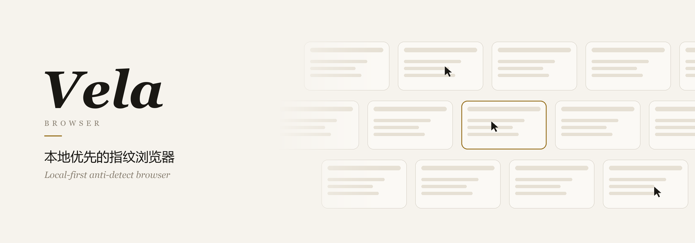

<p align="center">
  <picture>
    <source media="(prefers-color-scheme: dark)" srcset="docs/assets/banner-dark.png">
    
  </picture>
</p>

<p align="center">
  <a href="https://github.com/accomplish07zrh-eng/vela-browser/releases">下载</a>
  &nbsp;·&nbsp;
  <a href="#一面墙">工作台</a>
  &nbsp;·&nbsp;
  <a href="#交给-ai">AI 操控</a>
  &nbsp;·&nbsp;
  <a href="#从源码构建">从源码构建</a>
  &nbsp;·&nbsp;
  <a href="#in-english">English</a>
</p>

<br>

Vela 为每个环境准备一套独立的身份：指纹、代理、Cookie 和登录状态各归各的，互不相通。打开的环境都铺在同一面墙上，实时可见，随手可点。数据只存在你的电脑上：没有账号，没有云端，也不需要登录。

<br>

## 一面墙

打开 Vela，看到的就是工作台。每个运行中的环境是墙上的一块实时画面，一个分组占一行；行可以首尾相接、循环流动，相邻两行反向缓缓漂移。

- **直接操作**：双击任意一块即可放大，在里面点击、输入、滚动，和操作真实窗口一样。
- **同步**：把一个环境设为主控，其余环境跟随它的点击和键入。
- **分组**：只看某一行，或让当前行在墙上占据更大的位置。
- **安静**：Windows 上可以让环境窗口不出现在任务栏。这个开关只去掉任务栏按钮，窗口本身和网页能读到的一切都不变。

导航收在底部的浮动坞里，其他页面从下方升起，按 <kbd>Esc</kbd> 回到墙上。默认是纸白色，也有深色主题。

## 每个环境，一套身份

- **内核**：Vela Chromium 155、CloakBrowser 和 Vela Firefox，每个环境可以单独选择。WebKit 内核目前处于实验阶段。
- **指纹**：屏幕、字体、语音、媒体设备、WebGL 和 WebRTC 等参数按环境生成，并在整个生命周期内保持一致。
- **代理**：每个环境可以配置独立的 HTTP、HTTPS 或 SOCKS5 代理，并能检测连通性。
- **会话**：关闭时保存 Cookie 和本地存储，下次打开时原样恢复。
- **批量**：支持分组、导入导出、回收站和定时任务。

## 交给 AI

Vela 自带 MCP 服务，Claude Code、Cursor 等 AI 工具接入后即可创建环境、打开浏览器并操作网页。

- **拟人输入**：点击和悬停时，指针沿带加减速的曲线移动，落点分布在元素内部；需要时用滚轮滚动；文字逐键输入，节奏有快有慢。每个环境的手速和习惯固定不变，不同环境之间互不相同。
- **一窗一鼠标**：每个浏览器窗口有自己独立的指针和键盘。AI 可以同时操作多个窗口，彼此不抢占，也不会移动你电脑上的鼠标。
- **可开可关**：通过 `aliasmode_humanize` 关闭拟人输入，或调整整体速度。

另有一套本地 HTTP 接口，与 AdsPower 的 `/api/v1` 风格兼容，可以从脚本里启动环境，再用 Playwright 或 Puppeteer 连接。

## 安装

在 [Releases](https://github.com/accomplish07zrh-eng/vela-browser/releases) 下载 Windows 安装包。macOS 和 Linux 可以用安装脚本：

```bash
curl -fsSL https://raw.githubusercontent.com/accomplish07zrh-eng/vela-browser/main/scripts/install-macos.sh | bash
```

```bash
curl -fsSL https://raw.githubusercontent.com/accomplish07zrh-eng/vela-browser/main/scripts/install-linux.sh | bash
```

应用内更新使用独立签名，只接受本仓库发布的版本。

## 从源码构建

需要 [Bun](https://bun.sh) 1.4 或更高版本；构建桌面版还需要 Rust 和 [Tauri](https://tauri.app) 的依赖。

```bash
bun install
bun test
bun start
```

打包 Windows 桌面版：

```bash
bun run desktop:prepare
bun run desktop:build:nsis
```

## 目录

| 位置 | 内容 |
| --- | --- |
| `src/` | 环境管理、启动器、指纹、代理和本地服务 |
| `web/` | 界面：工作台、浮动坞和各个页面 |
| `src-tauri/` | 桌面外壳、安装器、应用内更新 |
| `agent/` | MCP 服务、拟人输入、脚本运行器 |
| `scripts/` | 打包、安装和验收脚本 |
| `docs/public/` | 本地 API 和 MCP 工具的公开说明 |
| 根目录 `*.mjs` | 浏览器后台进程；打包后与 `agent/` 同层，所以留在根目录 |

## 致谢与许可

Vela Browser 是 [AliasMode](https://github.com/aliasmode/aliasmode) 的独立分支，与上游项目及其维护者没有隶属或背书关系。

- 应用代码沿用 Apache License 2.0，原始代码版权归 Xreacher 所有。
- AliasMode Firefox 内核采用 MPL-2.0，AliasMode Chromium 内核采用 GPL-3.0。
- CloakBrowser 是第三方内核，适用其自身的许可条款。
- 字体、语音与媒体设备数据等第三方资源的版权和许可见 [`NOTICE`](NOTICE)。

<br>

## In English

Vela Browser is a local-first anti-detect browser. Every environment carries its own fingerprint, proxy, cookies and sessions, and all running environments live on one wall of live views that you can watch and use directly. There are no accounts and no cloud; data stays on your computer.

AI agents connect through the built-in MCP server. Clicks, hovers and typing are human-like by default, and every browser window has its own independent pointer and keyboard, so an agent can drive many windows at once without touching your real mouse. A local HTTP API in the style of AdsPower's `/api/v1` serves scripts.

Vela Browser is an independent fork of [AliasMode](https://github.com/aliasmode/aliasmode) under the Apache License 2.0, and is not affiliated with or endorsed by the upstream project. See [`NOTICE`](NOTICE) for third-party terms.
