<p align="center">
  <picture>
    <source media="(prefers-color-scheme: dark)" srcset="docs/assets/banner-dark.svg">
    
  </picture>
</p>

<p align="center">
  <b>中文</b>&nbsp;&nbsp;·&nbsp;&nbsp;<a href="README.en.md">English</a>
</p>

<p align="center">
  <a href="https://github.com/accomplish07zrh-eng/vela-browser/releases">启航</a>
  &nbsp;·&nbsp;
  <a href="#wall">一面墙</a>
  &nbsp;·&nbsp;
  <a href="#cooling">熄灯</a>
  &nbsp;·&nbsp;
  <a href="#agents">三双手</a>
  &nbsp;·&nbsp;
  <a href="#plugins">工具</a>
  &nbsp;·&nbsp;
  <a href="#build">造船</a>
</p>

<br>

<p align="center"><i>
一扇窗，一盏灯。<br>
灯下的人互不相识，<br>
也不必相识。
</i></p>

<p align="center"><sub>VELA　拉丁文里的「帆」，南天的船帆座</sub></p>

<br>

## 序

<p align="center">
你有许多扇窗。<br>
每一扇后面，都住着一个完整的人：<br>
他的指纹是一圈一圈的年轮，<br>
他的来路，是涨了又退的潮汐，<br>
他的 Cookie，是抽屉里一封没写完的信。
</p>

<p align="center">
他们从不串门。<br>
隔着一堵墙，各自点灯，各自睡去。
</p>

<p align="center">· · ·</p>

<p align="center">
而这面墙，就钉在你的书桌上。<br>
没有账号，没有云端，<br>
没有谁在远方，替你保管钥匙。
</p>

<br>

<a name="wall"></a>

## 壹　一面墙

<p align="center"><sub>THE WALL</sub></p>

<p align="center"><i>
一个分组是一行，一行是一条河。<br>
相邻的河逆向而流，<br>
灯火在两岸，隔水相望。
</i></p>

慢一点，再慢一点，\
像深夜的车窗外，一列对开的火车，\
一格一格，把别人的灯火拉过去。

　　然后你双击了其中一扇。

它朝你迎上来，\
整个世界缩成一个方框：\
可以点，可以写，可以一页一页往下翻，\
和真的窗口，没有两样。

你在一扇窗里落笔，\
别的窗也跟着落笔：一人领唱，众人相和，\
涟漪在同一个瞬间泛开。

<details>
<summary><b>灯下细看</b></summary>
<br>

- **直接操作**：双击墙上任意一块即可放大，在里面点击、输入、滚动，和操作真实窗口一样。
- **同步**：把一个环境设为主控，其余环境跟随它的点击和键入。横幅第一行那几圈一起泛开的涟漪就是它。
- **分组**：一个分组占一行，行可以首尾相接、循环流动，相邻两行反向漂移。可以只看某一行，或让它在墙上占据更大的位置。
- **安静**：Windows 上可以让环境窗口不出现在任务栏。只去掉任务栏按钮，窗口本身和网页能读到的一切都不变。
- **浮动坞**：导航收在底部，其他页面从下方升起，按 <kbd>Esc</kbd> 回到墙上。白天是纸白色，入夜有深色。

</details>

<br>

## 贰　千种来路

<p align="center"><sub>IDENTITIES</sub></p>

<p align="center"><i>
同一台电脑，千种来路。
</i></p>

有人从东京的雨里来，有人从柏林的雪里来，\
有人只说英文，有人开口就是吴侬软语。

屏幕有多宽，抽屉里有几种字体，\
声卡里藏着哪一副嗓子，\
显卡上落着什么颜色的灰，\
都记在他自己的名下，\
从第一次睁眼，到最后一次合眼，不改一笔。

　　他出门只走自己那条路，\
　　　　连替他跑腿的人，也走那一条。

门一关，信原样躺在抽屉里。\
下次推门，墨迹还没干。

<details>
<summary><b>灯下细看</b></summary>
<br>

- **内核**：Vela Chromium 155、CloakBrowser、Vela Firefox，每个环境单独选择；WebKit 处于实验阶段。
- **指纹**：屏幕、字体、语音、媒体设备、WebGL、WebRTC 等参数按环境生成，在整个生命周期内保持一致。
- **代理**：每个环境配置自己的 HTTP、HTTPS 或 SOCKS5 代理，可以检测连通性。环境往外发的请求，包括 AI 和插件替它发的，都只走这一条。
- **会话**：关闭时保存 Cookie 和本地存储，下次打开原样恢复。
- **批量**：分组、导入导出、回收站和定时任务。

</details>

<br>

<a name="cooling"></a>

## 叁　熄灯，不散场

<p align="center"><sub>COOLING</sub></p>

<p align="center">
  <picture>
    <source media="(prefers-color-scheme: dark)" srcset="docs/assets/cooling-dark.svg">
    
  </picture>
</p>

<p align="center"><i>
夜深了。<br>
最久没人照看的那扇窗，先熄了灯。
</i></p>

不是告别。

信折好了，收进抽屉；\
钥匙压在门口的花盆底下。\
屋子还挂在墙上，只是暗着，\
窗玻璃上结了一朵小小的霜花。

　　水位落下去，\
　　　　整台电脑，轻轻舒了一口气。

<p align="center"><i>
你回来的时候，<br>
茶还温着，<br>
书还翻在那一页。
</i></p>

<details>
<summary><b>灯下细看</b></summary>
<br>

- **何时**：系统内存占用连续越过阈值时，Vela 挑出闲置最久的那个浏览器，像你点「关闭」那样，先保存会话再关掉，把内存还给系统。
- **仍在墙上**：它不会从工作台消失，只是变暗，标着「已冷却」。点「唤醒」或双击它，登录状态和标签页都还在。
- **不会冷却**：你正在用的、脚本或 AI 正在操作的、刚刚动过的浏览器。
- **由你调**：默认内存占用 85%、闲置 10 分钟时开始；两项都能在设置里修改，也可以整个关掉。

</details>

<br>

<a name="agents"></a>

## 肆　一个念头，三双手

<p align="center"><sub>AGENTS</sub></p>

<p align="center">
  <picture>
    <source media="(prefers-color-scheme: dark)" srcset="docs/assets/agents-dark.svg">
    
  </picture>
</p>

<p align="center"><i>
一个念头，分作三双手。<br>
各写各的字，<br>
谁也不碰谁的笔。
</i></p>

指针走路的样子，像人：

起步，有一点迟疑，\
　　半途，快了起来，\
　　　　偶尔走过了头，\
　　　　　　又折回来，落定。

敲字也像人：\
一个键，　一个键，\
逢着句读，停下来，想一想。

<p align="center">· · ·</p>

窗外下着很大的雨。\
三扇窗里，三只鼠标同时在写信，\
而你桌上的那一只，一动不动。

F12 底下那条暗河，它也看得见：\
控制台里的低语，网络上往来的信件，\
WebSocket 里一刻不停的电报。

　　但每一扇门，它都先敲一敲。

<details>
<summary><b>灯下细看</b></summary>
<br>

- **接入**：Vela 自带 MCP 服务。Claude Code、Cursor 等 AI 工具接入后，可以创建环境、打开浏览器、操作网页。
- **拟人输入**：指针沿带加减速的曲线移动，长距离时偶尔略过头再修正，落点散在元素内部；需要时用滚轮滚动；文字逐键输入，节奏有快有慢，逢标点停顿。每个环境的手速和习惯固定，环境之间各不相同。用 `vela_humanize` 可以关闭或调速。
- **一窗一鼠标**：每个浏览器窗口有自己的指针和键盘。AI 可以同时操作多个窗口，彼此不抢占，也不会移动你电脑上的鼠标。
- **开发者工具**：读取控制台与异常堆栈、网络请求与原始响应、WebSocket 消息、DOM 与样式、Cookie 与站点存储；执行 JavaScript、修改存储、经由环境自身网络发出请求；Chromium 上可直接下发 CDP 命令。三个内核都连接环境原本的上下文，隔离、代理和指纹不变。
- **先问一声**：只读工具和会修改的工具分开标注，AI 客户端可以据此在调用前征求你的同意。读取 Cookie 时默认只返回当前页面会带上的那些，要整个环境的需要显式请求。
- **脚本**：本地 HTTP 接口与 AdsPower 的 `/api/v1` 风格兼容，可从脚本启动环境，再用 Playwright 或 Puppeteer 连接；JS 脚本可以用 `devtools.call(...)` 读取运行期间的控制台和网络记录。

</details>

<br>

<a name="plugins"></a>

## 伍　趁手的工具

<p align="center"><sub>PLUGINS</sub></p>

<p align="center"><i>
给远行的人，塞一把小刀，<br>
一卷绳子，一盏马灯。
</i></p>

在 `plugins` 里放一个文件夹，\
一份清单，一段代码，\
AI 就多会一样手艺：

```js
// plugins/page-info/index.mjs
export default function setup(vela) {
  return {
    async summary() {
      const page = vela.page();
      const errors = await vela.devtools("console", { level: "error" });
      return { title: await page.title(), errors: errors.records.length };
    },
  };
}
```

它只在此刻站着的那扇窗里用：\
拿那间屋子的钥匙，走那间屋子的路，\
合不上窗，也翻不进隔壁。

　　Chromium、Firefox、WebKit，\
　　　　三种灯，同一把小刀。

<details>
<summary><b>灯下细看</b></summary>
<br>

- **放在哪**：数据目录下的 `plugins/<插件名>/`，包含 `vela-plugin.json` 清单和一个 JS 模块；模块的 `setup(vela)` 为每个工具返回一个函数。上面的例子，AI 看到的工具名是 `plugin_page_info_summary`。
- **在哪运行**：在 AI 选中的环境里运行，使用该环境自己的上下文、登录、代理和指纹；不能关闭浏览器，各环境的插件状态互不相通。
- **设置**：「设置 → 高级 → 插件」列出每个插件和它的工具，可以逐个开关、打开插件文件夹，或一键添加示例插件。
- **写法**：见 [`docs/plugins.md`](docs/plugins.md)。插件是在你电脑上运行的代码，只安装你信任的。

</details>

<br>

## 陆　启航

<p align="center"><sub>INSTALL</sub></p>

<p align="center"><i>
帆已经挂好了。<br>
风从哪边来，都行。
</i></p>

Windows：在 [Releases](https://github.com/accomplish07zrh-eng/vela-browser/releases) 下载安装包。

macOS：

```bash
curl -fsSL https://raw.githubusercontent.com/accomplish07zrh-eng/vela-browser/main/scripts/install-macos.sh | bash
```

Linux：

```bash
curl -fsSL https://raw.githubusercontent.com/accomplish07zrh-eng/vela-browser/main/scripts/install-linux.sh | bash
```

<p align="center"><sub>应用内更新有自己的签名，只认本仓库发出的版本。</sub></p>

<br>

<a name="build"></a>

## 柒　造船

<p align="center"><sub>BUILD FROM SOURCE</sub></p>

<p align="center"><i>
想亲手造一条船，<br>
先备好木料与钉子。
</i></p>

需要 [Bun](https://bun.sh) 1.4.1 或更高版本；构建桌面版还需要 Rust 和 [Tauri](https://tauri.app) 的依赖。

```bash
bun install
bun test
bun start
```

打包 Windows 桌面版：

```bash
bun run desktop:prepare
bun run desktop:build:nsis
```

<p align="center"><sub>这一页会动的画，出自 <code>python scripts/make-readme-art.py</code>。<br>若你的系统请求减少动态效果，它们便安静地停在原地。</sub></p>

<details>
<summary><b>船上的物件</b></summary>
<br>

| 位置 | 内容 |
| --- | --- |
| `src/` | 环境管理、启动器、指纹、代理、冷却、插件清单和本地服务 |
| `web/` | 界面：工作台、浮动坞和各个页面 |
| `src-tauri/` | 桌面外壳、安装器、应用内更新 |
| `agent/` | MCP 服务、开发者工具、插件运行、拟人输入、脚本运行器 |
| `scripts/` | 打包、安装、验收和 README 插图脚本 |
| `docs/` | 插件与开发者工具说明，本地 API 和 MCP 工具的公开说明 |
| 根目录 `*.mjs` | 浏览器后台进程；打包后与 `agent/` 同层，所以留在根目录 |

</details>

<br>

## 跋

<p align="center"><i>
这条船的龙骨，来自另一条船。
</i></p>

Vela Browser 是 [AliasMode](https://github.com/aliasmode/aliasmode) 的独立分支，与上游项目及其维护者没有隶属或背书关系。

- 应用代码沿用 Apache License 2.0，原始代码版权归 Xreacher 所有。
- AliasMode Firefox 内核采用 MPL-2.0，AliasMode Chromium 内核采用 GPL-3.0。
- CloakBrowser 是第三方内核，适用其自身的许可条款。
- 字体、语音与媒体设备数据等第三方资源的版权和许可见 [`NOTICE`](NOTICE)。

<br>

<p align="center">· · ·</p>

<br>

<p align="center"><i>
Every window keeps its own lamp.<br>
<a href="README.en.md">The whole book, in English</a>
</i></p>
